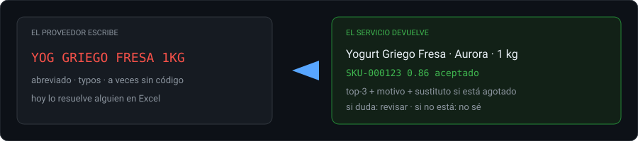
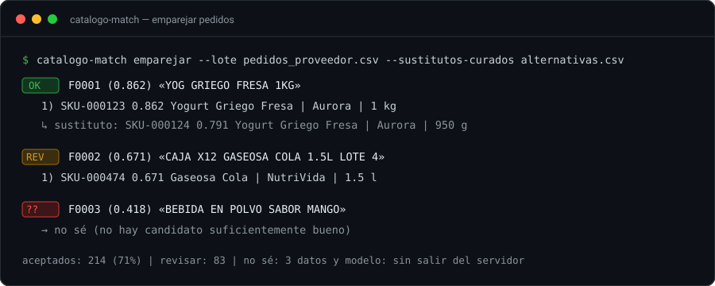
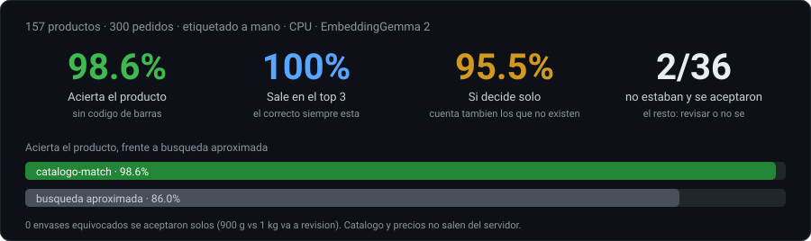
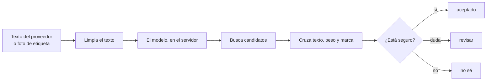

# catalogo-match

[](https://github.com/Ali-Cerna-Enciso/catalogo-match/actions/workflows/ci.yml)
[](LICENSE)
[](pyproject.toml)

Este repo usa [EmbeddingGemma 2](https://huggingface.co/google/embeddinggemma-2) (Apache-2.0) **en el servidor**, más reglas de texto, peso y marca. Busca una cosa: leer lo que escribe el proveedor y devolver el código de producto del catálogo, con qué confianza — o callarse si no corresponde.

Un pedido llega como `YOG GRIEGO FRESA 1KG`. En el catálogo es `Yogurt Griego Fresa · Aurora · 1 kg`. Compras, la tienda y el almacén pelean el mismo producto con tres nombres; el código de barras a veces no viene. Subir esa lista a la nube no es opción.

**El Excel de compras, en un servicio local.** Catálogo, fotos y precios no salen del servidor.





## Resultados

Prueba con etiquetas humanas: **157 productos, 300 pedidos**, EmbeddingGemma 2 en un PC sin tarjeta gráfica. El 98.6 % es **sin código de barras** (57 pedidos lo traían: esos no miden al modelo).



| | Acierta el producto | El correcto sale entre los 3 primeros | Si decide solo |
|---|---:|---:|---:|
| Búsqueda aproximada | 86.0 % | 93.6 % | — |
| **catalogo-match** | **98.6 %** | **100 %** | **95.5 %** |

El 95.5 % cuenta también los pedidos que **no estaban** en el catálogo. De 36 así, 2 se aceptaron solos (Fanta Zero cuando solo hay Fanta limón). Un envase distinto (900 g vs 1 kg) no se automatiza.

Cifras de un lote etiquetado a mano (no está en GitHub). En el repo hay datos de ejemplo para clonar y correr.

## Cómo funciona



El puntaje mezcla significado (66 %), texto (26 %), envase (8 %) y marca. El modelo es [EmbeddingGemma 2](https://huggingface.co/google/embeddinggemma-2). No hace falta GPU.

## Probarlo

```bash
python -m venv .venv && .venv/Scripts/activate   # Linux/macOS: source .venv/bin/activate
pip install --index-url https://download.pytorch.org/whl/cpu torch torchvision
pip install -e ".[modelo,api]"
python tools/descargar_modelo.py                  # una vez, ~1–2 GB
export HF_HUB_OFFLINE=1

catalogo-match generar-datos
catalogo-match indexar --backend gemma --maestro data/sintetico/maestro.csv --salida salidas/indice
catalogo-match emparejar --indice salidas/indice --lote data/sintetico/lote_sucio.csv \
  --salida salidas/resultados.jsonl
```

Sin descargar el modelo: `--backend hash`. Servicio HTTP: `catalogo-match servir --indice salidas/indice`.

Cómo operarlo → [docs/OPERACION.md](docs/OPERACION.md). El modelo → [docs/MODELO.md](docs/MODELO.md).

Apache-2.0. Datos de ejemplo: CC0. El catálogo de una empresa no se sube al repo (`data/privado/`).
